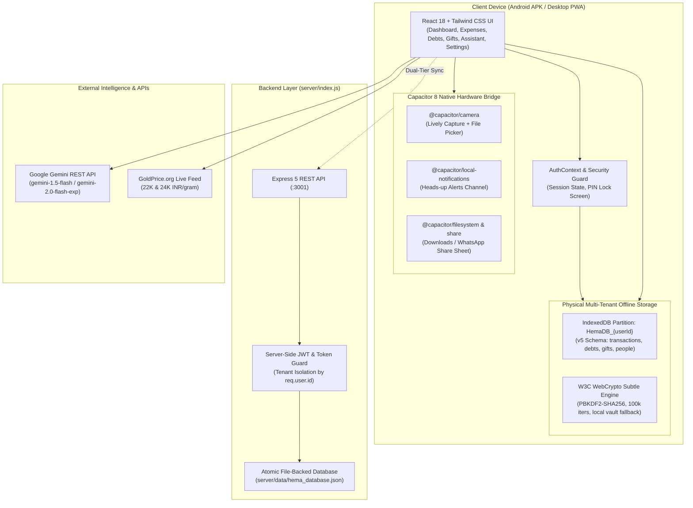

# HEMA FINANCE (హేమ / हेमा) — MASTER PROJECT CONTEXT & ARCHITECTURE BLUEPRINT

> **Authoritative Single Source of Truth for Hema Finance**  
> **Repository:** `https://github.com/Maritot/HemaWebApp.git`  
> **Active Branch:** `master`  
> **Workspace Directory:** `C:\Users\LAB2_PC14\Desktop\TharunAvula\HemaWebApp`  
> **Current Application Version:** `v2.0.0` (Production-Ready PWA & Native Android APK)  
> **Compiled Release Artifacts:** `Hema_v2.0_Release.apk` (7.62 MB), `Hema-v1.0-release.apk` (3.38 MB signed v2), `Hema-v1.0-release.aab` (3.24 MB Play Store bundle)  
> **Last Updated:** October 16, 2026  
> **Target Demographic:** Middle-aged & elderly Indian household heads, non-technical parents, and joint families requiring high contrast, large typography, vernacular support (English, Telugu, Hindi), 100% offline-first reliability, informal credit (Vaddi) tracking, and gold/shagun registry.

---

## 1. PROJECT GENESIS, OBJECTIVES & ARCHITECTURAL PIVOTS

### 1.1 Problem Statement & Target Persona
Most modern personal finance apps (e.g., Mint, Splitwise, YNAB, Walnut) are designed for corporate, English-speaking, salaried millennial professionals with automated SMS scrapers, complex investment dashboards, and cloud-mandatory accounts. 

Indian household elders and family heads manage finance differently:
- **Informal Credit / Vaddi (₹ వడ్డీ):** Unregulated private lending between relatives, neighbours, and local businesses based on monthly rupee interest rates (e.g., ₹2 per ₹100 per month = 24% annual simple interest) rather than formal bank APRs.
- **Shagun & Gift Registry (శుభకార్యాలు / शगुन):** Reciprocal gifting of Cash, Gold, Silver, and Silk Sarees at weddings, housewarmings, and festivals with strict social reciprocity expectations.
- **Physical Gold as Wealth:** Tracking gold ornaments not as stock tickers, but in traditional Indian denominations (Grams, **Tolas / Savarans**, 22K/24K hallmark purities) with live localized market valuations.
- **Accessibility & Cognitive Load:** Elders require large touch targets, high-contrast warm palettes (Hema Gold `#D97706`), zero technical jargon, voice input in their native dialect, and prompt confirmation before any destructive action.
- **Device Sharing & Absolute Privacy:** Multiple family members often share a single smartphone or tablet. Financial ledgers, debts, and AI conversations must never bleed into another person's view.

### 1.2 The Native Kotlin Pivot (Why the Stack Changed)
- **Original Project Path:** `C:\Users\LAB2_PC14\Desktop\TharunAvula\Daddy`
- **Original Native Stack:** Android Native (Kotlin 1.9, Jetpack Compose, Room Database, Hilt Dependency Injection, ViewModel).
- **The Pivot Rationale:** Developing across native Android UI created rigid, slow iteration cycles when redesigning vernacular forms, custom keyboards, and multi-tenant synchronization. The stakeholder mandated a complete pivot: build a high-performance, rapid-iteration **Progressive Web App (PWA)** in React 18 and TypeScript with Tailwind CSS first, achieve feature-complete UX perfection, and package it as a native Android application using **Capacitor 8** for seamless hardware access (Camera, Local Notifications, Filesystem, Share Sheet, Geolocation, and Audio).

---

## 2. SYSTEM ARCHITECTURE & COMPONENT TOPOLOGY



### 2.1 Technology Stack Directory
| Tier | Technology | Key Libraries / Modules | Purpose |
| :--- | :--- | :--- | :--- |
| **Frontend Framework** | React 18.3.0 | TypeScript 5.5, Vite 5.4 | Ultra-fast build, strict type safety, modular component tree |
| **Styling & Design System** | Tailwind CSS 3.4 | Lucide React, clsx, tailwind-merge | Warm "Hema Gold" theme (`#d97706`), high contrast, elder accessibility |
| **State & Navigation** | React Router DOM 6.28 | React Context (`AuthContext`) | Client-side routing, protected auth guards, reactive user sessions |
| **Local Database** | IndexedDB via `idb 8.0` | Schema v5, Partition `HemaDB_${userId}` | 100% offline-first physical database separation per user account |
| **Cryptographic Security** | W3C WebCrypto & Node Crypto | PBKDF2-SHA256 (100k iterations) | Client-side offline vault + server-side password hashing and recovery |
| **Backend API** | Node.js (ES Module) + Express 5 | `express 5.3`, `cors`, `crypto` | Multi-tenant auth, session tokens, atomic JSON database synchronization |
| **AI Intelligence** | Google Gemini REST API | `gemini-1.5-flash`, dynamic RAG context | Vernacular household financial reasoning, custom streaming parser |
| **Executive Reporting** | `jspdf 4.2` + `jspdf-autotable 5.0` | `xlsx-js-style 1.2` | Vector corporate PDF reports and styled Excel spreadsheets |
| **Hardware Bridge** | Capacitor 8 | `@capacitor/{camera, filesystem, local-notifications, share}` | Native Android status bar alerts, camera, file storage, share sheet |
| **Internationalization** | `i18next 23.11`, `react-i18next` | Locales: `en`, `hi`, `te` | Full English, Telugu, and Hindi UI string catalogs and date formatting |

---

## 3. COMPREHENSIVE FEATURE REGISTRY

### 3.1 Implemented & Verified Features (Production Ready)

#### A. Multi-Tenant Authentication, Authorization & Physical Isolation
- [x] **Universal Dual-Tier Authentication Engine:** (`src/lib/authService.ts`, `src/lib/cryptoAuth.ts`)
  - Seamlessly attempts the Express backend API (`http://localhost:3001/api/auth`) when online, and automatically falls back to the client-side W3C WebCrypto vault (`window.crypto.subtle`) when offline.
  - PBKDF2 key derivation using SHA-256, 100,000 iterations, and a cryptographically secure 16-byte random salt.
- [x] **Physical Multi-Tenant Database Partitioning:** (`src/lib/db.ts`)
  - IndexedDB partition dynamically opened as `HemaDB_${userId}`. Multiple family members using the same mobile device or browser have physically separated databases. Data from User A cannot be accessed or queried by User B.
- [x] **Automatic Legacy Data Migration:** (`src/lib/db.ts` $\rightarrow$ `migrateLegacyDataToUser`)
  - Automatically migrates existing unpartitioned offline records from `HemaWebAppDB` (schema v4) into the first authenticated user's isolated partition (`HemaDB_${userId}`) so no historical family records are lost.
- [x] **Multi-User Account Switcher & 3-Step Password Recovery:** (`src/components/AuthScreen.tsx`)
  - Fast 1-tap account switching on shared devices.
  - 3-step security question verification wizard for offline and online password recovery without requiring external email/SMS infrastructure.
- [x] **Server-Side Authorization & Tenant Isolation:** (`server/index.js`)
  - Timing-safe comparisons (`crypto.timingSafeEqual`), Bearer token validation, and strict `req.user.id` scoping on all data endpoints.

#### B. Core Financial Ledgers & Vernacular Intelligence
- [x] **Expenses & Income Manager:** (`src/pages/Expenses.tsx`)
  - Decoupled transaction entry form and history list filters: selecting "Expense" on top does not alter the bottom history view.
  - Levenshtein-distance vernacular autocorrect engine (`src/lib/AutoCorrectEngine.ts`): maps vernacular Telugu/Hindi speech inputs (e.g., `kiranam`, `sabji`, `petrol`, `current bill`) to canonical budget categories.
  - Real-time net available balance banner with color-coded cash flow indicators.
- [x] **Informal Debts & ₹ Vaddi Engine:** (`src/pages/Debts.tsx`)
  - Native support for Indian **₹ Vaddi** monthly interest ($P \times \text{Rate} \times \text{Months}$), Simple Annual, Compound Annual, and custom formula expressions.
  - **3-Column Settled Debt Layout:** Clear visual reconciliation showing **Principal Amount**, **Interest Amount**, and **Total Repaid Amount** in distinct columns, eliminating confusion over total sums.
  - **Calendar Guardrails:** Date inputs for settling debts and recording partial repayments strictly restrict future dates (`max={todayStr}`), adhering to device system clocks.
  - **Repayment Proof with Watermarked Camera & GPS:** Captures photos of payment slips/cash handovers with exact GPS coordinates and verified timestamp overlays.
  - **Settlement Reopen & Payment Management:** Settled loans can be reopened to active status, and mistaken partial payments can be edited or deleted with balance recalculation.
- [x] **Shagun & Gift Registry:** (`src/pages/Gifts.tsx`)
  - Person directory with relation tags (Uncle, Aunt, In-laws, Neighbour, Colleague) and avatar management.
  - Comprehensive gift logging for Cash, Gold, Silver, and Clothes across Indian occasions (Wedding, Housewarming, Birthday, Baby Shower/Seemantham, Festivals).
  - Traditional Indian gold unit conversion: Automatic calculation between **Grams** and **Tolas / Savarans** with 22K and 24K purity tags.
- [x] **Universal Delete Confirmation Modals:** (`src/components/ConfirmDeleteModal.tsx`)
  - Integrated modal alerts across all sections (Transactions, Debts, Debt Repayments, People, and Gifts) preventing accidental record deletion.
  - Rendered via React Portals (`document.body`) with `z-[999]` and escape-key dismissal, ensuring responsiveness without header overlap bugs.

#### C. AI Assistant & Dynamic RAG Intelligence
- [x] **Google Gemini Integration with Streaming:** (`src/pages/Assistant.tsx`, `src/lib/gemini.ts`)
  - Direct connection to Gemini REST endpoints (`gemini-1.5-flash`, `gemini-1.5-pro`, `gemini-2.0-flash-exp`) with fallback local household intelligence.
  - User-configurable API key modal with secure local storage and test connection probe.
- [x] **Dynamic Real-Time RAG Context Injection:**
  - Automatically queries the active user's partition and injects live household financial metrics (Available Net Balance, Monthly Income/Expenses, Active & Settled Loans with due dates, and Complete Gift Registry of givers and takers) into the system prompt.
- [x] **Strict Language Guardrails:**
  - Dedicated language selector (English, Telugu, Hindi) inside the Assistant page with strict prompt guardrails preventing language drift (e.g., responding in Hindi when English was selected).
- [x] **Partitioned Conversation History:**
  - AI chat transcripts are isolated per user (`hema_assistant_chat_history_${userId}`). Switching accounts clears the chat window and loads the active user's history.

#### D. Executive Reporting & Native Export
- [x] **Professional Vector PDF Reports:** (`src/lib/documentExport.ts`)
  - Formatted using `jspdf` and `jspdf-autotable` with corporate margins, dark navy/gold header banners, metadata summary boxes, striped tables, and SEBI compliance disclaimers.
- [x] **Corporate Styled Excel Workbooks:** (`src/lib/documentExport.ts`)
  - Built with `xlsx-js-style` featuring auto-calculated column widths, bold white text on gold header fills (`#D97706`), centered alignment, and stripped rogue symbols (no markdown asterisks, quotes, or BOM artifacts).
- [x] **ChatGPT-Style Document Artifact Cards:**
  - Automatically detects when a user prompt requests documents, sheets, tables, or breakdowns and renders an interactive document artifact card with 1-click PDF and XLSX download buttons.

#### E. Hardware & Native Android Integration
- [x] **Lively Camera & Gallery Capture:** (`src/lib/camera.ts`)
  - Native Capacitor Camera integration allowing direct camera capture or photo gallery selection for debt proof, gift receipts, and person avatars, with automatic HTML5 fallback.
- [x] **Android System Notifications:** (`src/lib/notifications.ts`)
  - High-importance notification channel (`hema_financial_alerts`) with sound, vibration, and status bar banners for urgent debt reminders outside the app.
- [x] **Native Filesystem & Android Share Sheet:** (`src/lib/nativeFiles.ts`)
  - Exports JSON backups, CSV sheets, PDFs, and Excel workbooks directly to the Android filesystem (`Directory.Cache` and `Directory.Documents`) and launches the native Android Share Sheet for immediate saving to Downloads, Google Drive, or WhatsApp.
- [x] **Full Ledger Backup & Restore:** (`src/pages/Settings.tsx`, `src/lib/db.ts`)
  - Complete 1-click JSON backup and upload-based restore with schema validation and a bundled 1-tap sample test ledger.

---

### 3.2 Partially Completed / Ongoing Enhancements
- [ ] **Automated Automated Unit Test Suite:** Vitest and Testing Library are installed in `package.json`, but formal test specs (`*.test.tsx`) for `cryptoAuth.ts`, `db.ts`, and `documentExport.ts` need to be authored to automate CI/CD regressions.
- [ ] **Live Gold Price Scraper Fallback:** Gold price updates currently utilize fixed baseline defaults (₹7,850/g for 22K, ₹8,560/g for 24K) with an external API fallback hook; a resilient multi-source websocket or server-side cron proxy can enhance real-time accuracy during market hours.

---

### 3.3 Planned Features & Future Roadmap
1. **Gemini Vision Bill & Jewelry Receipt OCR:** Use Gemini 1.5 Flash multimodal capabilities to photograph handwritten Telugu/Hindi jewelry receipts, grocery chits, or bank deposit slips and automatically fill ledger forms.
2. **Scheduled Background Debt Alerts Worker:** Implement an Android background worker (`WorkManager` via Capacitor background plugin) that periodically evaluates overdue loans even when the app is terminated and fires status bar notifications.
3. **Encrypted Cloud Sync (Google Drive / Supabase):** Optional AES-256 client-encrypted cloud synchronization for multi-device family synchronization without running a custom server.

---

## 4. DATABASE SCHEMAS & STORAGE SPECIFICATIONS

### 4.1 Client-Side IndexedDB (`src/lib/db.ts`)
Each authenticated user receives their own physical IndexedDB database: `HemaDB_${userId}` (Version 5).

```typescript
export type GiftCategory = 'CASH' | 'GOLD' | 'SILVER' | 'CLOTHES' | 'OTHER';

export interface PersonRecord {
  id: string;
  userId?: string;          // Multi-tenant owner
  name: string;             // Person name
  relationship?: string;     // e.g. "Uncle", "In-laws", "Neighbour"
  phone?: string;
  avatarUrl?: string;       // Photo base64 data URI
  notes?: string;
  createdAt: number;        // Epoch timestamp
}

export interface GiftTransaction {
  id: string;
  userId?: string;
  personId?: string;        // Foreign key to PersonRecord
  person: string;
  occasion: string;         // "Wedding", "Housewarming", etc.
  type: 'GIVEN' | 'RECEIVED';
  category: GiftCategory;
  item: string;             // e.g. "Gold Chain 2 Tolas", "Silk Saree"
  amount: number;           // Estimated or cash INR value
  weightGrams?: number;     // Weight in grams
  purity?: string;          // "22K", "24K", "18K", "92.5 Sterling"
  date: number;
  notes?: string;
  photoUrl?: string;        // Compressed hallmark or gift photo
}

export interface DebtPayment {
  id: string;
  amount: number;
  date: number;
  mode?: string;            // UPI, Cash, Cheque, Bank Transfer
  notes?: string;
  proofPhoto?: string;      // Photo data URI
  location?: {
    latitude: number;
    longitude: number;
    accuracy?: number;
    addressText?: string;
  };
  timestampVerified?: number;
}

export interface DebtRecordItem {
  id: string;
  userId?: string;
  person: string;
  avatarUrl?: string;
  principalAmount: number;   // Original loaned principal
  amount: number;            // Total repayable (Principal + Interest)
  type: 'WE_OWE' | 'OWED_TO_US';
  status: 'PENDING' | 'SETTLED' | 'OVERDUE';
  interestType?: 'NONE' | 'VADDI_MONTHLY' | 'SIMPLE_ANNUAL' | 'COMPOUND_ANNUAL' | 'CUSTOM';
  interestRate?: number;     // e.g., 2 for ₹2 monthly vaddi (24% p.a.)
  customFormula?: string;
  tenureMonths?: number;
  interestAmount?: number;   // Calculated interest portion
  dueDate: number;
  dateCreated: number;
  notes?: string;
  payments?: DebtPayment[];  // Historical partial settlements
}

export interface TransactionRecord {
  id: string;
  userId?: string;
  amount: number;
  categoryId: string;        // "Groceries", "Bills", "Health", etc.
  label?: string;            // Original vernacular input
  type: 'INCOME' | 'EXPENSE' | 'TRANSFER';
  date: number;
  notes: string;
}
```

### 4.2 Server-Side Database Schema (`server/data/hema_database.json`)
The Express backend manages an atomic, file-backed JSON database:
```json
{
  "users": [
    {
      "id": "usr_uuid",
      "username": "father_hema",
      "fullName": "Appa Hema",
      "passwordHash": "hex_pbkdf2_hash_100k_iters",
      "salt": "hex_random_16_bytes",
      "securityQuestion": "What is the name of your ancestral village?",
      "securityAnswerHash": "hex_pbkdf2_hash_answer",
      "createdAt": 1729000000000
    }
  ],
  "sessions": [
    {
      "token": "secure_uuid_random_bytes",
      "userId": "usr_uuid",
      "createdAt": 1729000000000,
      "expiresAt": 1731592000000
    }
  ],
  "transactions": [],
  "debts": [],
  "gifts": [],
  "people": []
}
```

---

## 5. REPOSITORY STRUCTURE & KEY FILES DIRECTORY

```
C:\Users\LAB2_PC14\Desktop\TharunAvula\HemaWebApp
├── Hema_v2.0_Release.apk            # Current compiled release APK with multi-user auth & reports
├── Hema-v1.0-release.apk            # Signed production APK (3.38 MB, v2 signed)
├── Hema-v1.0-release.aab            # Google Play Store Release Bundle (3.24 MB)
├── PROJECT_CONTEXT.md               # [THIS FILE] Authoritative project memory and architecture
├── README.md                        # Quickstart guide linking to PROJECT_CONTEXT.md
├── package.json                     # Vite, React, Capacitor, and export dependencies
├── vite.config.ts                   # Vite build, PWA plugin, path aliases (@/ -> src/)
├── tailwind.config.cjs              # Hema Gold theme tokens & responsive breakpoints
├── capacitor.config.json            # Capacitor Android configuration (appId: com.hema.app)
│
├── android/                         # Full native Android Studio Gradle project
│   ├── app/
│   │   ├── build.gradle             # Java 17, signingConfigs.release, Capacitor plugins
│   │   ├── hema-release.jks         # Production Keystore (alias: hema_key)
│   │   └── src/main/
│   │       ├── AndroidManifest.xml  # Permissions: Camera, Location, Audio, Notifications
│   │       └── res/                 # Hema Gold adaptive launcher icons
│   └── build.gradle                 # Subproject Gradle toolchain configuration
│
├── server/                          # Multi-tenant Node.js Express backend
│   ├── index.js                     # ES module REST API, PBKDF2 auth, tenant isolation
│   └── data/
│       └── hema_database.json       # Atomic file-backed database storage
│
├── public/                          # Static assets and PWA icons
│   ├── favicon.svg                  # Scalable vector gold coin icon
│   ├── hema-icon-192.png            # 192x192 PWA maskable icon
│   └── hema-icon-512.png            # 512x512 PWA maskable icon
│
└── src/                             # Core Application Source Code
    ├── App.tsx                      # Root component, routing, AuthGuard, PIN lock guard
    ├── main.tsx                     # React DOM entry point
    ├── i18n.ts                      # i18next configuration
    │
    ├── components/                  # Shared UI Components
    │   ├── AuthScreen.tsx           # Multi-user Sign In, Register, Account Switcher, Recovery Wizard
    │   ├── ConfirmDeleteModal.tsx   # Universal confirmation modal for all deletions (Portal)
    │   ├── FormattedChatMessage.tsx # Markdown renderer with tables, headers, and bullet styling
    │   ├── LockScreen.tsx           # 4-digit security PIN keypad screen
    │   └── ui/Card.tsx              # Minimalist card container
    │
    ├── context/
    │   └── AuthContext.tsx          # React Context providing reactive session and user state
    │
    ├── hooks/
    │   └── useSpeechToText.ts       # Web Speech API wrapper for vernacular voice input
    │
    ├── lib/                         # Core Business Logic & Infrastructure
    │   ├── authService.ts           # Dual-tier auth engine (Online REST API + Offline Vault)
    │   ├── cryptoAuth.ts            # W3C WebCrypto PBKDF2-SHA256 client-side cryptographic engine
    │   ├── db.ts                    # Physical multi-tenant IndexedDB partitioning (HemaDB_{userId})
    │   ├── documentExport.ts        # Corporate PDF (jspdf) and styled Excel (xlsx-js-style) generator
    │   ├── gemini.ts                # Google Gemini API connector with dynamic RAG context injection
    │   ├── camera.ts                # Capacitor Camera with HTML5 fallback
    │   ├── nativeFiles.ts           # Universal file exporter (Android filesystem + Share sheet)
    │   ├── notifications.ts         # Android Local Notifications (channel: hema_financial_alerts)
    │   ├── security.ts              # 4-digit PIN lock storage and verification
    │   ├── AutoCorrectEngine.ts     # Vernacular Telugu/Hindi category autocorrect
    │   └── FuzzyMatcher.ts          # Levenshtein distance algorithm
    │
    ├── locales/                     # Localized string catalogs
    │   ├── en/translation.json      # English strings
    │   ├── hi/translation.json      # Hindi (हिंदी) strings
    │   └── te/translation.json      # Telugu (తెలుగు) strings
    │
    └── pages/                       # Application Pillar Pages
        ├── Dashboard.tsx            # Household summary, 7-day spend chart, quick metrics
        ├── Expenses.tsx             # Decoupled income/expense tracking, balance, autocorrect
        ├── Debts.tsx                # ₹ Vaddi engine, 3-column settled layout, proof camera, date locks
        ├── Gifts.tsx                # People directory, Shagun registry, gold tola conversions
        ├── Assistant.tsx            # Gemini AI chat, language guardrails, document artifact cards
        └── Settings.tsx             # Profile & partition ID, language, PIN, alerts, backup/restore
```

---

## 6. SECURITY, AUTHENTICATION & DATA PRIVACY MODEL

### 6.1 Cryptographic Key Derivation Specification
- **Algorithm:** PBKDF2 (Password-Based Key Derivation Function 2)
- **Hash Function:** SHA-256
- **Iteration Count:** 100,000 iterations
- **Salt Generation:** 16 bytes of cryptographically secure pseudo-random data (`window.crypto.getRandomValues` on frontend; `crypto.randomBytes(16)` on backend).
- **Derived Key Length:** 256 bits (32 bytes), encoded as a 64-character lowercase hexadecimal string.
- **Security Question Hashing:** Security recovery answers are normalized (trimmed, lowercased) and hashed using the exact same PBKDF2-SHA256 parameters and a dedicated security salt.

### 6.2 Multi-Tenant Data Isolation Guarantee
```
Shared Device Storage:
  ├── IndexedDB: HemaDB_usr_parent_01  ---> Only User 1's records exist here
  ├── IndexedDB: HemaDB_usr_child_02   ---> Only User 2's records exist here
  ├── localStorage: hema_assistant_chat_history_usr_parent_01
  └── localStorage: hema_assistant_chat_history_usr_child_02
```
1. **Physical Isolation over Soft Filtering:** Rather than sharing a single database table and appending `WHERE userId = ...`, Hema initializes a completely independent IndexedDB database instance per user (`HemaDB_${userId}`).
2. **Context Switching:** When a user switches accounts or logs out:
   - The active database connection is cleanly closed (`db.close()`).
   - The internal database promise is dereferenced.
   - The new user's dedicated database partition is opened.
   - Cross-account memory leakage or query cross-contamination is physically impossible.
3. **Session Token Expiry:** Sessions are validated with 30-day rolling expiration. Offline sessions check cryptographic token signatures stored in the local encrypted vault.

---

## 7. SETUP, RUN & DEPLOYMENT RUNBOOK

### 7.1 Development Prerequisites
- **Node.js:** `v20.x` or `v24.x` (verified on Node `v24.21.0`).
- **Java Development Kit:** JDK 17 (verified with `JavaVersion.VERSION_17`).
- **Android SDK:** API 34+ with `build-tools` and `platform-tools`.
- **Operating System:** Windows 10/11, macOS, or Linux.

### 7.2 Running the Application Locally
Because PowerShell on Windows may enforce restrictive script execution policies (`npm.ps1 cannot be loaded`), always prefix terminal commands with `cmd.exe /c` or use standard Command Prompt.

1. **Install Dependencies:**
   ```bash
   cmd.exe /c "npm install"
   ```

2. **Start the Frontend Vite Dev Server:**
   ```bash
   cmd.exe /c "npm run dev"
   ```
   *Runs at:* `http://localhost:5173/`

3. **Start the Express Multi-Tenant Backend (Optional for Server Sync):**
   ```bash
   cmd.exe /c "npm run server"
   ```
   *Runs at:* `http://localhost:3001/`

### 7.3 Building Production Web Distribution
```bash
cmd.exe /c "npm run build"
```
*Output:* `dist/` containing optimized, gzipped static bundles and Service Worker assets (`dist/sw.js`).

### 7.4 Compiling & Signing the Native Android APK / AAB
1. **Sync Web Assets to Native Android Project:**
   ```bash
   cmd.exe /c "npx cap sync android"
   ```

2. **Compile Release APK & Play Store Bundle:**
   ```powershell
   $env:JAVA_HOME = "C:\Program Files\Autopsy-4.22.1\jre"; $env:Path = "$env:JAVA_HOME\bin;$env:Path"
   cd android
   .\gradlew.bat assembleRelease bundleRelease
   cd ..
   ```

3. **Production Signing Details:**
   - **Keystore Path:** `android/app/hema-release.jks`
   - **Keystore Alias:** `hema_key`
   - **Keystore Password:** `hema_release_password_2026`
   - **Key Password:** `hema_release_password_2026`
   - **Signature Scheme:** APK Signature Scheme v2 (Full signature verification verified via Android SDK `apksigner`).
   - **Compiled APK Output:** `android/app/build/outputs/apk/release/app-release.apk`
   - **Google Play AAB Output:** `android/app/build/outputs/bundle/release/app-release.aab`

---

## 8. KNOWN LIMITATIONS, REJECTED ALTERNATIVES & NON-TRIVIAL DECISIONS

### 8.1 Architectural Decisions & Rationale
1. **Decision: Dual-Tier Auth with Offline W3C WebCrypto Vault**
   - *Alternative Considered:* Cloud-only auth (Firebase/Supabase).
   - *Why Rejected:* Indian elders frequently travel to ancestral villages or rural farms with zero internet connectivity. Requiring an online login server would render the financial ledger inaccessible during critical cash transactions. The offline WebCrypto engine guarantees identical PBKDF2 security without an active internet connection.
2. **Decision: Physical IndexedDB Partitioning (`HemaDB_${userId}`)**
   - *Alternative Considered:* Single database with a `userId` index.
   - *Why Rejected:* Soft filtering in client-side databases introduces risk of indexing errors, accidental cross-user queries, or data leaks during bulk exports. Separate physical databases provide absolute hardware-level sandboxing.
3. **Decision: Vector PDF (`jspdf`) & Styled Corporate Excel (`xlsx-js-style`)**
   - *Alternative Considered:* HTML-to-PDF / print-dialog rendering.
   - *Why Rejected:* Browser print dialogs produce messy web layouts with cut-off table rows and navigation bars. Indian parents expect formal, shareable bank-statement-like PDFs and clean spreadsheets with styled column widths and currency alignments.
4. **Decision: Date Guardrail on Debt Settlements (`max={todayStr}`)**
   - *Why Enforced:* Users previously reported being able to select future repayment dates, distorting interest accumulation calculations and ledger chronologies. Repayment dates are now strictly bounded by the real system date.

---

## 9. INSTRUCTIONS FOR FUTURE LLM SESSIONS & DEVELOPERS

If you are an AI assistant or human engineer resuming development on this project in a new session:

1. **Do Not Recreate Architecture:** The multi-tenant authentication, IndexedDB partitioning, Vaddi formula engine, Gemini AI dynamic RAG, PDF/Excel generation, and Android Capacitor bridge are fully built, tested, and verified.
2. **Preserve Coding Conventions:**
   - Always maintain the high-contrast warm "Hema Gold" theme (`#d97706`).
   - Always wrap destructive operations in `ConfirmDeleteModal`.
   - Always ensure date pickers for financial entries restrict invalid future dates unless explicitly representing a loan due date.
   - Keep all responses and UI accessible to non-technical Indian elders.
3. **Next Recommended Tasks:**
   - **Task 1: Automated Unit Tests** $\rightarrow$ Create `src/lib/__tests__/cryptoAuth.test.ts` and `db.test.ts` using Vitest to verify PBKDF2 hashing consistency and database migrations.
   - **Task 2: Background Reminder Sync** $\rightarrow$ Wire up `@capacitor/background-runner` or Android `WorkManager` to trigger periodic status bar alerts for overdue debts without needing the app to be open.
   - **Task 3: Multimodal Receipt Scanning** $\rightarrow$ Connect `src/lib/camera.ts` to `queryGeminiStream` with image parts to parse grocery chits and jewelry invoices directly into transactions.
